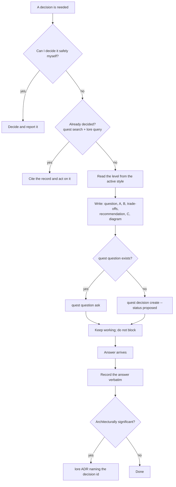

# Operator questions

Use this skill when a decision needs the operator's call: an irreversible one, or
one outside what was delegated to you. It does two jobs.

1. **Shape** one question for the person who decides. A and B with one
   recommendation, a free-text C, the trade-offs on cost, quality and speed, and
   a Mermaid diagram. The question is sized to the active Plain English level.
2. **File and record** the question and its answer in Quest. When the decision is
   architecturally significant, it also becomes an ADR in Lore.

The output style shapes every reply. This skill loads only when a question is
being asked, so it can carry rules too long for a style file: the diagram types,
the Quest and Lore commands, and the worked examples.

The same flow in words: decide it yourself if you safely can. If you cannot,
cite an earlier decision if one exists. Otherwise write the question at the
reader's level, file it in Quest and keep working. When the answer arrives,
record it, and write an ADR when the decision is architecturally significant.

**Never ask for a decision you can make yourself.** That rule is the styles'
own, extended here to a decision someone already made: search before you ask.

## The question, at every level

Every question has these parts, in this order. The order puts the decision first
(bottom line up front), so the reader can stop after the recommendation.

1. **The question.** One line naming what the operator decides. Add why it needs
   them: it cannot be undone, or it is outside what was delegated.
2. **A** and **B.** One line each. The recommended option is A and is marked
   "(Recommended)". The two options are real alternatives; neither is a decoy
   built to make the other look good.
3. **Trade-offs.** Each option on cost, quality and speed, naming which one it
   gives up.
4. **Recommendation.** One option, one reason. Also say what happens if nobody
   answers, and when, because a recommendation acts as the default.
5. **C — your own answer.** One line: "C: tell me a different answer." C is never
   compared, scored or recommended. It is the free-text way out of a false
   choice.
6. **Diagram.** One Mermaid diagram, then one line saying in words what it shows.

### C is not a third option

All three styles say "two options, never three", and the harness check
`two_options_max` scores a reply against that. This skill keeps A and B and adds
C as the free-text route, not a third alternative — the same "Other" row that
Claude Code's own question tool appends. Three considered options can improve
decision quality, but a decoy third option distorts the choice. A free-text C
gives the operator the escape without that distortion.

### The tie rules stand

When the options are close, or both are poor, say so in the first line.
Recommend one anyway, and name the one fact that would flip the pick. C does not
count as a way out of a tie.

**One question per message.** Two decisions are two questions, filed separately.

## Get the level first

The skill obeys the active style's limits and adds nothing to the word budget.
Read the level from the style instructions you can already see — there is no hook
field or environment variable for it. When no Plain English style is active, use
**Intermediate**. The operator can name a level for one question ("ask me that at
Advanced").

| | Beginner | Intermediate | Advanced |
|---|---|---|---|
| Reader | executive, no code | product owner, reads concepts | staff engineer |
| Words (diagram excluded) | 80 | 100 | 120 |
| A and B | one everyday line each | one line each, terms glossed once | one line each, name the mechanism |
| Trade-offs | prose: "cheaper", "better", "faster" | a 2-row table: cost, quality, speed | the table with numbers, plus reversibility and blast radius |
| Confidence | not shown | "likely" or "unsure" | named: high, medium or low, and on what evidence |
| If nobody answers | one plain sentence | one sentence with the date | the default, the date and the cost of waiting |
| Diagram | `flowchart LR`, at most 5 nodes, everyday words | flowchart, sequence or state, at most 8 nodes | any type below, at most 12 nodes |
| Diagram labels | the Beginner banned-term list applies | glossed terms allowed | technical terms allowed |

The full table, the per-level rules, and the worked examples are in
[levels.md](levels.md).

## Draw it

Every question ends with one Mermaid diagram and one line saying what it shows.
Which type to use, the node caps, the placement rules, and where each type
renders are in [diagrams.md](diagrams.md).

## File it, and record the answer

Search first, file the question in Quest without blocking, and record the
operator's answer verbatim. The commands, the fallback when the question record
does not exist yet, and the Lore ADR are in
[quest-and-lore.md](quest-and-lore.md).

## What this skill does not do

- It does not redraw the question tool's `preview` field; a mod cannot reach it.
  Put the diagram in the message text above the question.
- It does not build `quest question`; it detects that command by presence.
- It does not decide who is asked. The skill shapes and files a question; the
  routing of operator questions is not its business.
