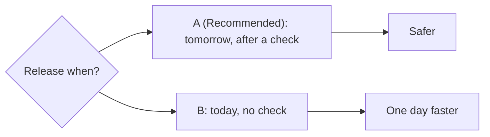

# Levels

The numbers come from `harness/config/contracts.json`. The rules come from the
three style files. The skill obeys the active style's limits; it adds nothing to
the word budget.

| | Beginner | Intermediate | Advanced |
|---|---|---|---|
| Reader | executive, no code | product owner, reads concepts | staff engineer |
| Words (diagram excluded) | 80 | 100 | 120 |
| Sentence / paragraph | 20 words / 4 sentences | same | same |
| Banned terms | 28, unglossed | 10, unglossed | none |
| A and B | one everyday line each | one line each, terms glossed once | one line each, name the mechanism |
| Trade-offs | prose: "cheaper", "better", "faster" | a 2-row table: cost, quality, speed | the table with numbers, plus reversibility and blast radius |
| Confidence | not shown | "likely" or "unsure" | named: high, medium or low, and on what evidence |
| If nobody answers | one plain sentence | one sentence with the date | the default, the date and the cost of waiting |
| Diagram | `flowchart LR`, at most 5 nodes, everyday words | flowchart, sequence or state, at most 8 nodes | any type in diagrams.md, at most 12 nodes |
| Diagram labels | the Beginner banned-term list applies | glossed terms allowed | technical terms allowed |

When no Plain English style is active, use **Intermediate**. The operator can
name a level for one question ("ask me that at Advanced").

The model already holds its active style in context. There is no documented hook
field or environment variable for the style, so read the level from the style
instructions you can see, not from settings files.

## Worked examples

The same question at each level: whether to ship a release now or wait one day
for a second review.

### Beginner (64 words)

> **Should we release the update today or tomorrow?** You decide, because a
> release cannot be taken back.
>
> **A (Recommended):** Release tomorrow, after one more check.
> **B:** Release today, with no extra check.
>
> A is safer and costs nothing. B is one day faster.
>
> I recommend A: the extra check finds mistakes before people see them. If I hear
> nothing, I wait until tomorrow.
>
> **C:** Tell me a different answer.

The diagram shows the two choices and what each one gives you.

### Intermediate

Adds a trade-off table and glosses its terms:

> | | Cost | Quality | Speed |
> |---|---|---|---|
> | **A** | none | a second review (a check by a different reviewer) | +1 day |
> | **B** | none | one review | today |

It uses a `flowchart` or `sequenceDiagram` with up to 8 nodes.

### Advanced

Names the mechanism and the numbers:

> **A (Recommended):** hold the tag 24 h for an independent Opus review.
> **B:** push the tag now on the author's review alone.
> Reversibility: a pushed tag is a one-way door (re-tagging is tier 3).
> Confidence in A: high. The last release missed a crossing ruling the same way.

It may use a `quadrantChart` of risk against delay.
