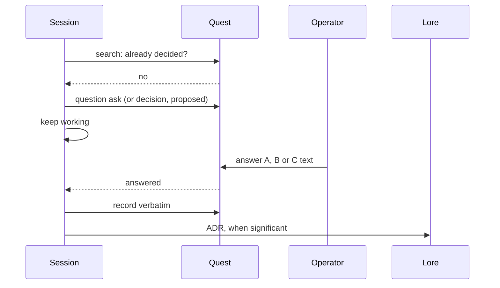

# Quest and Lore

The skill files the question in Quest and, when the decision is architecturally
significant, records it as an ADR in Lore.

## Before asking

- `quest search "<topic>" --all --json` and `lore query "<topic>"`. If a decision
  or ADR already answers the question, cite it and act; do not ask. This is the
  styles' "never ask for a decision you can make yourself", extended to a
  decision someone already made.
- Name the records the question rests on, by id, in the question's context.

## Filing the question

Detect Quest's question record **by presence, never by version**: `quest help
question` exits 0.

- **When it exists:**
  `quest question ask --title … --context … --option A=… --option B=… --recommend A`.
  The `context` holds the trade-offs and the diagram's Mermaid source, so it
  renders wherever the record is shown as Markdown. C is **not** an `--option`;
  it is the `--text` route that `quest question answer` already has.
- **Until then:** `quest decision create "<question>" --status proposed`. The
  context holds the options, the recommendation, the trade-offs and the diagram.
  The skill does not wait on it: a non-urgent question is filed and work goes on.

Every write carries `--actor … --actor-kind delegated-agent --accountable-human …`.

## Recording the answer

- Record the operator's words **verbatim**: A, B, or the C text.
- With the question record, use `quest question answer`. Until then, edit the
  decision to `accepted` and write the outcome as "A" or "B" with the verbatim
  text, or the C text verbatim.
- A task blocked on the question names it, or links the decision id.

## When the answer is architecturally significant

Write an ADR with Lore: `lore new adr "<decision>"`, or `--out` where the
repository's ADRs are unnumbered. Use the MADR sections:

- context and problem;
- considered options, A and B, with C as the operator's own text when chosen;
- the decision outcome ("Chosen option: A, because …");
- the consequences.

The diagram goes in the ADR as Mermaid, where GitHub renders it. The ADR names
the decision id, and the decision names the ADR back. `lore check` exiting 0 is
done.
